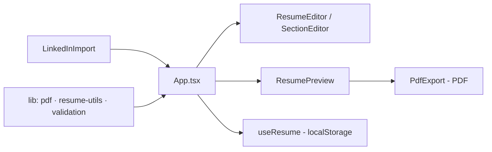

# gerador-curriculos-ats-v2

**English** · [Português (Brasil)](README.md)

[](#) [](#) [](#) [](#) [](#) [](LICENSE)

## What it is

An **ATS-friendly résumé builder** (version 2): the user assembles a résumé section by section, can **import data from a LinkedIn profile**, edit each block (education, experience, skills, languages, certifications) and **export to PDF**. It is a React 18 + TypeScript + Tailwind app, with validation and PDF-generation logic separated and tested (Vitest).

## Status

Under development, working and tested (39 tests). Build validated.

## Features

- **LinkedIn profile import** (`LinkedInImport`): fills the draft from imported data.
- **PDF export** (`PdfExport`): generates the résumé PDF from the preview.
- **Section editor** (`ResumeEditor`, `SectionEditor`): personal data, education, experience, skills, languages, certifications.
- **Live preview** (`ResumePreview`) in an ATS-friendly layout.
- **Persistence** in `localStorage` (the `useResume` hook).
- **Separate testable logic**: `resume-utils` (model assembly), `validation` and `pdf` (generation).
- **Build/scripts**: `dev`, `build` (tsc --noEmit && vite build), `test` (vitest run), `preview`.

## Architecture

React UI components (`src/components`) + hooks (`useResume`) + `src/lib` (pdf, resume-utils, validation) holding the testable business logic. `App.tsx` orchestrates the flow (LinkedIn import → edit → preview → export).



## Stack

- React 18.3, TypeScript ~5.6
- Vite 5, Tailwind CSS 3.4
- Vitest 2 + jsdom (tests)
- npm 11

## Repository layout

```
gerador-curriculos-ats-v2/
├── src/
│   ├── App.tsx · main.tsx
│   ├── components/     # LinkedInImport, PdfExport, ResumeEditor,
│   │                   # ResumePreview, SectionEditor, FormField, Icons
│   ├── hooks/useResume.ts   # state + localStorage
│   ├── lib/            # pdf.ts, resume-utils.ts, validation.ts (+ tests)
│   └── index.css
├── index.html · package.json · vite.config.ts
├── tailwind.config.js · postcss.config.js
└── LICENSE             # MIT
```

## Prerequisites and installation

Node.js (npm).

```bash
git clone https://github.com/KelvinOliveiraCode/gerador-curriculos-ats-v2.git
cd gerador-curriculos-ats-v2
npm install
```

## How to run

```bash
npm run dev         # development server
npm test            # vitest run
npm run build       # production build (tsc --noEmit && vite build)
npm run preview     # preview the build
```

## Tests and quality

Real run (verified by the agent):

```bash
npm test
# 39 passed (3 files): validation 12, resume-utils 15, pdf 12
npm run build
# built in 3.18s
```

There is no CI configured in this repository.

## Technical decisions and trade-offs

- **Logic separated from the UI in `src/lib`**: validation, model assembly and PDF generation are testable without the DOM.
- **localStorage via `useResume`**: simple in-browser persistence, no backend.
- **LinkedIn import as a shortcut**: reduces the effort of filling a résumé from an existing profile.

## Known limitations and roadmap

- The LinkedIn import depends on the format of the input data.
- No verified live deployment (the URL in the repository returns 404 in this pass).
- No CI configured.

## Development process

An individual project by Kelvin Oliveira, built with orchestrated AI agents and reviewed by the author. The component architecture, the PDF logic and the review are the author's.

## License and author

MIT — Copyright (c) 2026 Kelvin Rebelo de Oliveira.

**Author**: [Kelvin Oliveira](https://github.com/KelvinOliveiraCode) · [Portfolio](https://kelvinoliveiracode.github.io/portfolio/)
