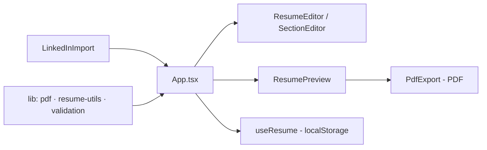

# gerador-curriculos-ats-v2

[English](README.en.md) · **Português (Brasil)**

[](#) [](#) [](#) [](#) [](#) [](LICENSE)

## O que é

**Gerador de currículos ATS-friendly** (versão 2): o usuário monta um currículo por seções e consegue **importar dados de um perfil do LinkedIn**, editar cada bloco (formação, experiência, habilidades, idiomas, certificações) e **exportar em PDF**. É um app React 18 + TypeScript + Tailwind, com lógica de validação e geração de PDF separadas e testadas (Vitest).

## Status

Em desenvolvimento, funcional e testado (39 testes). Build validado.

## Funcionalidades

- **Importação de perfil do LinkedIn** (`LinkedInImport`): preenche o rascunho a partir de dados importados.
- **Exportação PDF** (`PdfExport`): gera o PDF do currículo a partir do preview.
- **Editor de seções** (`ResumeEditor`, `SectionEditor`): dados pessoais, formação, experiência, habilidades, idiomas, certificações.
- **Preview** (`ResumePreview`) em tempo real, em layout ATS-friendly.
- **Persistência** em `localStorage` (hook `useResume`).
- **Lógica testável separada**: `resume-utils` (montagem do modelo), `validation` (validação) e `pdf` (geração).
- **Build/scripts**: `dev`, `build` (tsc --noEmit && vite build), `test` (vitest run), `preview`.

## Arquitetura

Componentes React de UI (`src/components`) + hooks (`useResume`) + lib (`src/lib`: pdf, resume-utils, validation) que concentram a lógica de negócio testável. O `App.tsx` orquestra o fluxo (importar LinkedIn → editar → preview → exportar).



## Stack

- React 18.3, TypeScript ~5.6
- Vite 5, Tailwind CSS 3.4
- Vitest 2 + jsdom (testes)
- npm 11

## Estrutura do repositório

```
gerador-curriculos-ats-v2/
├── src/
│   ├── App.tsx · main.tsx
│   ├── components/     # LinkedInImport, PdfExport, ResumeEditor,
│   │                   # ResumePreview, SectionEditor, FormField, Icons
│   ├── hooks/useResume.ts   # estado + localStorage
│   ├── lib/            # pdf.ts, resume-utils.ts, validation.ts (+ testes)
│   └── index.css
├── index.html · package.json · vite.config.ts
├── tailwind.config.js · postcss.config.js
└── LICENSE             # MIT
```

## Pré-requisitos e instalação

Node.js (npm).

```bash
git clone https://github.com/KelvinOliveiraCode/gerador-curriculos-ats-v2.git
cd gerador-curriculos-ats-v2
npm install
```

## Como executar

```bash
npm run dev         # servidor de desenvolvimento
npm test            # vitest run
npm run build       # build de produção (tsc --noEmit && vite build)
npm run preview     # pré-visualiza o build
```

## Testes e qualidade

Execução real (verificada pelo agente):

```bash
npm test
# 39 passed (3 arquivos): validation 12, resume-utils 15, pdf 12
npm run build
# built in 3.18s
```

Não há CI configurado neste repositório.

## Decisões técnicas e trade-offs

- **Lógica separada da UI em `src/lib`**: validação, montagem do modelo e geração de PDF são testáveis sem o DOM.
- **localStorage via `useResume`**: persistência simples no navegador, sem backend.
- **Importação LinkedIn como atalho**: reduz o esforço de preencher o currículo a partir de um perfil existente.

## Limitações conhecidas e roadmap

- A importação do LinkedIn depende do formato dos dados de entrada fornecidos.
- Sem deploy vivo verificado (a URL no repositório retorna 404 nesta passada).
- Sem CI configurado.

## Processo de desenvolvimento

Projeto individual de Kelvin Oliveira, construído com agentes de IA orquestrados e revisado pelo autor. A arquitetura de componentes, a lógica de PDF e a revisão são do autor.

## Licença e autor

MIT — Copyright (c) 2026 Kelvin Rebelo de Oliveira.

**Autor**: [Kelvin Oliveira](https://github.com/KelvinOliveiraCode) · [Portfólio](https://kelvinoliveiracode.github.io/portfolio/)
